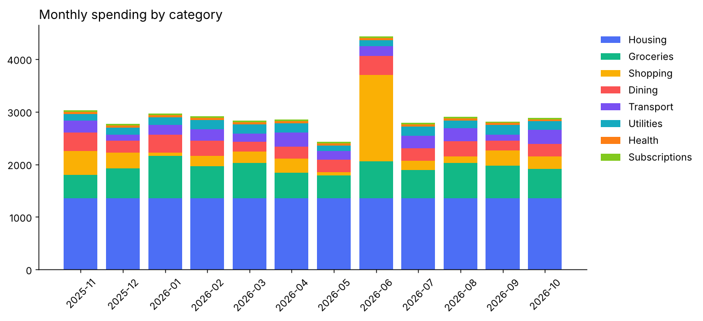
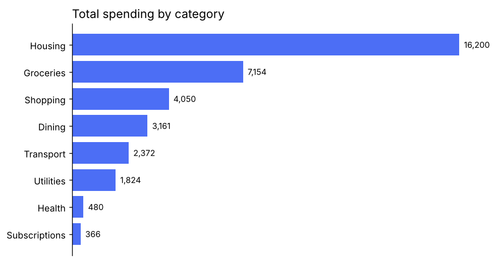

# 💸 spendlens

[](https://github.com/talhaarshadqa/spendlens/actions)


**Turn a bank-statement CSV into spending insight.** spendlens categorizes your transactions,
finds your subscriptions, flags unusual spending, and builds a one-page HTML report with charts.



## ✨ What it does

- **Reads most bank CSVs**: detects common column names (`Date` / `Transaction Date`, `Description` / `Details` / `Payee`, …) and handles both a signed `Amount` column and separate `Debit` / `Credit` columns, currency symbols, thousands separators and `(12.50)`-style negatives
- **Cleans merchant names**: `AMAZON MKTPL*2K4 #8812` becomes `AMAZON MKTPL`
- **Categorizes** with keyword rules you can extend in a TOML file
- **Finds recurring charges** (subscriptions, rent, gym) and shows their yearly cost
- **Flags anomalies**: expenses far above normal for their category (z-score)
- **Reports**: a terminal summary, a standalone HTML report with charts, and a categorized CSV export

## 🚀 Quick start

```bash
git clone https://github.com/talhaarshadqa/spendlens.git
cd spendlens
pip install -e .
spendlens examples/sample_transactions.csv -o report.html -c '$'
```

```text
Period:        2025-11-01 -> 2026-10-27  (431 transactions)
Income:        $51,300.00
Spending:      $35,606.52
Net:           $15,693.48  (savings rate 31%)

Spending by category:
  Housing          $16,200.00  45.5%  ##############################
  Groceries         $7,154.42  20.1%  #############
  Shopping          $4,049.59  11.4%  #######
  Dining            $3,160.77   8.9%  #####
  ...

Recurring charges:
  RENT PAYMENT LANDLORD     $1,350.00/mo  ~$16,200.00/yr
  GYM FITNESS CLUB             $39.99/mo  ~$479.88/yr
  NETFLIX.COM                  $15.49/mo  ~$185.88/yr
  ...

Unusual expenses:
  2026-06-18  AMAZON MKTPL*LAPTOP             $1,499.00  (15.9x typical Shopping)
```

## 🛠️ Options

| Flag | Description |
|---|---|
| `-o, --html FILE` | Write an HTML report with charts |
| `-r, --rules FILE` | Custom categorization rules (TOML) |
| `-c, --currency SYM` | Currency symbol for output, e.g. `'$'` or `'Rs '` |
| `--export FILE` | Save the categorized transactions as CSV |

### Custom rules

```toml
# rules.toml - checked before the built-in rules
[rules]
Coffee = ["starbucks", "costa"]
"Side projects" = ["github", "aws", "digitalocean"]
```

```bash
spendlens statement.csv -r rules.toml
```

## 🧠 How it works

| Step | Module | Technique |
|---|---|---|
| Load | `loader.py` | Column auto-detection, regex cleaning, `pd.to_numeric` |
| Categorize | `categorize.py` | Ordered keyword rules, TOML overrides |
| Subscriptions | `analysis.py` | Same merchant in 3+ months with a coefficient of variation under 10% |
| Anomalies | `analysis.py` | Per-category z-score (> 2.5σ) |
| Report | `report.py` | matplotlib charts embedded as base64 in a single HTML file |



## 🧪 Development

```bash
pip install -e ".[dev]"
pytest --cov=spendlens
python examples/generate_sample.py   # regenerate the sample data
```

## 📄 License

MIT
